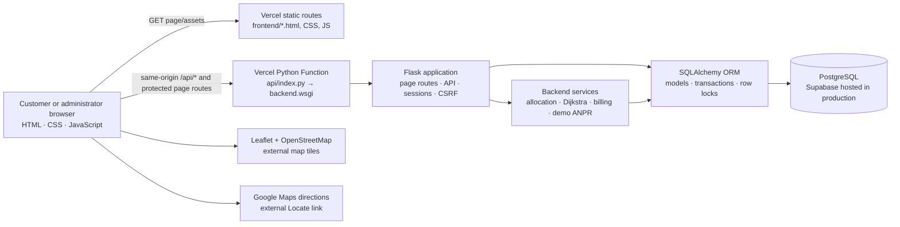
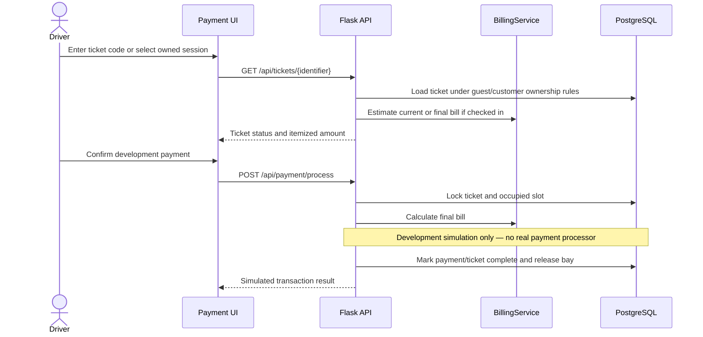

# SMARTPARK Architecture

This document describes the system as implemented in the repository. SMARTPARK
is a software-only parking application: physical IoT hardware and real payment
processing are not active integrations.

## At a glance



Locally, Flask serves both the page routes and frontend files. On Vercel,
`vercel.json` dispatches API and session-aware routes to the Python function
and sends selected pages and remaining static assets to the frontend static
build. The browser calls the API using same-origin `/api` paths.

## Technology stack

| Concern | Implementation |
| --- | --- |
| Web UI | HTML5, CSS3, vanilla JavaScript |
| Map | Leaflet 1.9.4 and OpenStreetMap tiles |
| Directions out to facility | Google Maps directions URL built from configured latitude and longitude |
| Web/API framework | Flask 3, with Flask-CORS configured for optional direct cross-origin API access |
| Runtime | Python 3.12 on Vercel, selected by `.python-version` |
| Serverless entrypoint | `api/index.py` imports `backend.wsgi.app` |
| Data access | SQLAlchemy 2 ORM and psycopg2 PostgreSQL driver |
| Production database | PostgreSQL, documented with Supabase |
| QR pass image | Backend-side `qrcode` and Pillow; private/no-store response |
| Local tests | pytest and in-memory SQLite |
| Deployment config | `vercel.json`, `backend/production.env.example`, and ordered SQL migrations |

## Component responsibilities

### Frontend: `frontend/`

- `index.html` provides public parking availability, aggregate capacity,
  zone filters, the Leaflet map, and Google Maps Locate link.
- `booking.html` handles selecting a vehicle and parking bay, creating a
  reservation, and presenting its ticket/QR pass.
- `payment.html` supports ticket lookup, estimates/final billing, and the
  simulated payment action.
- `customer*.html` pages support customer sign-in, registration, account,
  booking, session, and payment history experiences.
- `admin*.html` pages provide administrator login, dashboard, QR scanning,
  and operational slot controls.
- `app.js` contains same-origin API requests, session/CSRF token handling,
  polling, slot rendering, booking, ticket, and payment UI logic.
- `style.css` provides the customer/shared responsive design; `admin.css`
  styles administrator-specific views.

### Flask application: `backend/`

- `app.py` is the app factory, registers the API blueprint, configures
  sessions/CORS, and serves the page routes when running as a conventional
  Flask server.
- `wsgi.py` sets production defaults and exports the Flask `app`.
- `routes.py` implements API endpoints, input validation, authentication,
  role checks, CSRF enforcement, rate limiting, and transaction boundaries.
- `config.py` reads process environment variables and local `backend/.env`
  configuration; production requires database and secret configuration.
- `database.py` defines SQLAlchemy models, initializes connections, and seeds
  the configured administrator and development parking inventory.
- `services.py` holds the bay-selection heap, facility graph and Dijkstra
  routing, tariff calculation, and prototype ANPR behavior.

### Vercel Python entrypoint

```text
Browser
  ├── static page/asset → Vercel static output
  └── /api/* or protected page → api/index.py
                                  └── backend.wsgi.app
                                      └── Flask app and API blueprint
```

The Vercel runtime is stateless. Durable tickets, users, rate-limit state,
parking status, and logs belong in PostgreSQL, not process memory or a local
SQLite file. Keep the same strong `FLASK_SECRET_KEY` configured across
deployments so Flask sessions can be validated consistently.

## Data model

SQLAlchemy maps the application to these PostgreSQL tables:

| Table | Role |
| --- | --- |
| `users` | Customer accounts and configured administrator identity records where used. Passwords are stored as hashes. |
| `login_attempts` | Shared database-backed login and sensitive lookup throttling windows. |
| `parking_slots` | Physical bay number, zone, type, floor, availability state, vehicle, and update time. |
| `bookings_and_tickets` | Reservation/session lifecycle, owner, slot foreign key, QR timestamps, entry/exit, bill, and payment status. |
| `gate_logs` | Entry/exit audit events and notes. |
| `sensor_telemetry` | Legacy telemetry schema retained for compatibility; hardware webhook integration is retired. |
| `system_config` | Persisted configuration values such as initial tariff settings. |

`bookings_and_tickets.slot_id` references `parking_slots.id` with delete
restriction to preserve historical ticket relations. Removing a bay from
operation therefore does not require deleting its database row. The active
facility inventory is ground-level only; old non-ground-level rows are
excluded from availability and capacity, and are retired as maintenance when
released.

`database/schema.sql` is a destructive fresh-database script and contains
`DROP` statements. The numbered files in `migrations/` are explicit upgrades;
the app does not apply migrations automatically at startup. See
[migrations/README.md](./migrations/README.md).

## Authentication and trust boundaries

- Customer registration creates `CUSTOMER` accounts only. Customer and
  administrator sessions are separate.
- The administrator login uses the configured `ADMIN_USERNAME` and
  `ADMIN_PASSWORD`; customer passwords are hashed in the database.
- Administrator APIs check the session role. Mutating admin endpoints require
  a valid CSRF token.
- Customer-owned ticket lookup and QR image generation scope records to the
  signed-in customer. Guest ticket details use a ticket code and only return
  eligible guest-owned records.
- Login failures, ticket lookups, and payment attempts use database-backed
  throttling so limits are shared between serverless invocations.
- ORM query parameter binding is used for SQL data access.
- Secrets and PostgreSQL connection URLs are server-side configuration; they
  must not be included in frontend assets or committed files.

## Key request flows

### Reservation and QR check-in

```mermaid
sequenceDiagram
    actor Driver
    participant UI as Browser UI
    participant API as Flask API
    participant Alloc as Slot allocation service
    participant DB as PostgreSQL
    actor Admin

    Driver->>UI: Select vehicle and slot preference
    UI->>API: POST /api/slots/reserve
    API->>DB: Validate ticket/vehicle and lock eligible bay
    API->>Alloc: Choose compatible nearest bay if no bay specified
    Alloc->>DB: Update slot to RESERVED
    API->>DB: Create active ticket and QR expiry
    API-->>UI: Ticket and navigation details
    Admin->>UI: Scan or enter ticket token
    UI->>API: POST /api/admin/qr/scan-entry
    API->>DB: Validate active, unexpired ticket; lock ticket and slot
    API->>DB: Set entry timestamp; change bay to OCCUPIED
    API-->>UI: Entry/check-in result
```

The QR is a signed-in customer/guest-scoped image generated by the backend;
scanning triggers server-side ticket lookup rather than trusting client-
provided booking details.

### Billing, simulated payment, and release



Upcoming reservations are estimate-only. Billing begins after check-in. The
development payment action is not a real transaction and must not be used to
claim that actual funds have been collected.

## Allocation, routing, and billing

### Slot allocation

`SlotAllocationService` queries available ground-level bays, orders the
database candidates consistently, locks them for the transaction, and filters
by vehicle compatibility. Compatible candidates are pushed into a Python
`heapq` with vehicle/slot compatibility priority followed by distance from
entry; the best candidate is popped and updated. Candidate selection requires
heap insertion and removal work; do not describe the whole operation as
constant time.

### Indoor navigation

`ParkingFacilityGraph` represents entry, aisle, parking-bay, and exit nodes as
a weighted adjacency list. Dijkstra's algorithm finds the shortest path from
the entry gate to the selected bay and returns distance and directions. This
is an indoor schematic route, not a live GPS navigation feed.

The external Leaflet map shows the configured facility location. Its
**Locate** link opens Google Maps directions to those configured coordinates.

### Billing

`BillingService` uses rates from environment-backed configuration. It
calculates duration from actual entry to exit, includes the first billable
hour in the base rate, rounds subsequent time up to whole hours, applies the
configured peak multiplier, and adds a simulated 5% GST line. Upcoming
reservation estimates do not start a billable parking session.

## Software-only and retired integrations

- There is no active physical gate, camera, IR sensor, or ESP32 firmware
  integration. Hardware webhook paths return `410 Gone`.
- Direct unauthenticated automatic-entry and retired demo-entry paths return
  `410 Gone`; the protected administrator QR scanner is the supported check-in
  workflow.
- `ANPRService` is prototype/demo behavior. It can normalize a provided plate,
  generate sample plates, or return heuristic image results. It is not a
  production OCR system and should not decide real-world access.
- Payment method labels are simulated values, not connections to a card,
  UPI, bank, or payment gateway.
- `sensor_telemetry` and hardware-related model/service code remain as legacy
  implementation details; their presence does not mean deployed hardware is
  integrated.

## Related documentation

- [README.md](./README.md) — installation, configuration, routes, deployment,
  tests, and demonstration walkthrough.
- [migrations/README.md](./migrations/README.md) — PostgreSQL schema setup and
  guarded migration procedure.
- [vercel.json](./vercel.json) — deployment routing.
